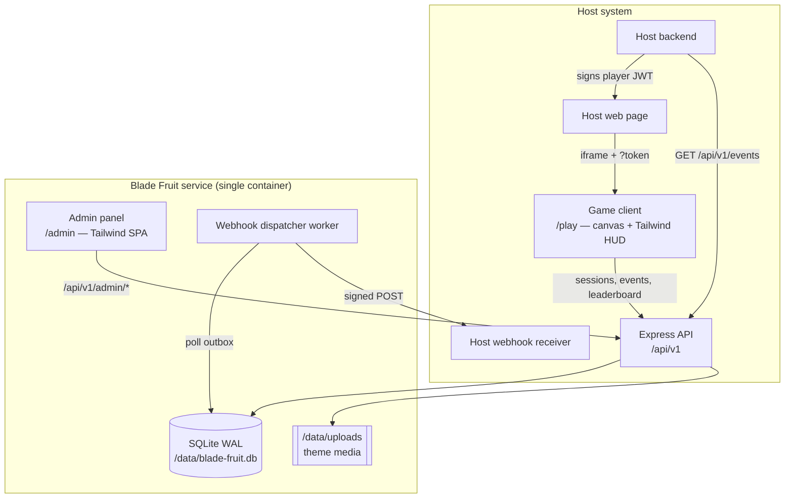
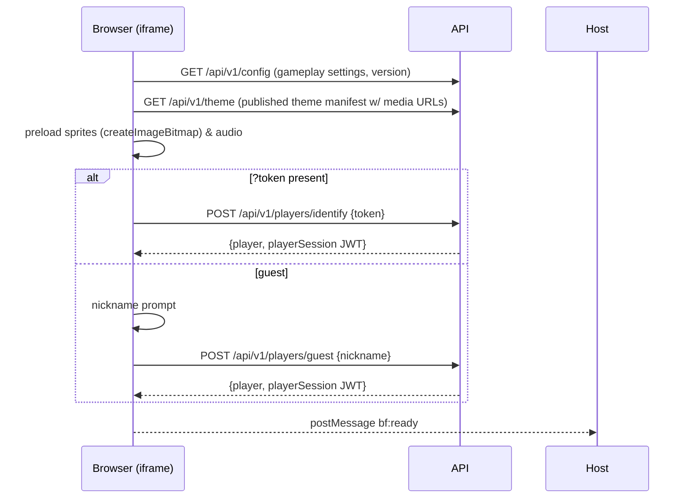
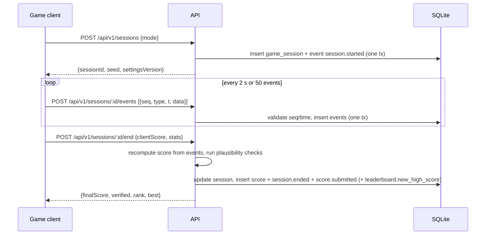

# Architecture — Blade Fruit Game Service

## 1. Overview

One Node.js process serves three things: the **game client**, the **admin panel**, and the **REST API**. A
background **webhook dispatcher** runs in the same process (a timer-driven worker) and can be split out later.
State lives in one SQLite file (WAL mode) plus an uploads directory, both under `/data`.



## 2. Components

| Component | Tech | Responsibility |
|---|---|---|
| Game client | HTML, Tailwind, vanilla ES modules, Canvas 2D, Web Audio | Rendering, input, physics, local scoring, batching events to API |
| Admin panel | HTML, Tailwind, vanilla ES modules (hash router) | Theme editor, settings, events explorer, leaderboard moderation, webhooks, API keys |
| API | Express 5, `zod` validation, `pino` logging, `helmet`, `express-rate-limit` | Sessions, events ingestion, scoring validation, leaderboard, config/theme, admin |
| Persistence | `better-sqlite3` behind repository modules | Synchronous, transactional, fast single-writer DB |
| Media | `multer` (memory) + `sharp` re-encode → `/data/uploads` | Safe sprite/audio storage, content-hashed filenames |
| Webhook dispatcher | `setInterval` worker, native `fetch` | Reads outbox, fans out to endpoints, retries, logs deliveries |

## 3. Repository Layout

```
.
├── .env.example
├── package.json
├── Dockerfile / docker-compose.yml
├── tailwind.config.js
├── src/styles/
│   ├── game.css            # @tailwind base/components/utilities + game HUD components
│   └── admin.css
├── public/
│   ├── css/                # Tailwind build output (gitignored)
│   ├── game/
│   │   ├── index.html
│   │   ├── assets/default/ # bundled default theme (sprites, sfx) + manifest.json
│   │   └── js/
│   │       ├── main.js             # boot: identity, config, theme, screens
│   │       ├── api.js              # fetch wrapper, session + event batching
│   │       ├── bridge.js           # postMessage contract with host
│   │       ├── engine/  loop.js physics.js input.js trail.js collision.js audio.js assets.js pool.js
│   │       ├── entities/ fruit.js half.js bomb.js special.js particle.js splat.js popup.js
│   │       ├── modes/   classic.js arcade.js zen.js   (spawning/scoring imported from /shared)
│   │       └── ui/      hud.js menu.js gameover.js leaderboard.js nickname.js
│   └── admin/
│       ├── index.html
│       └── js/ main.js router.js api.js
│           views/ login.js dashboard.js theme.js settings.js events.js leaderboard.js webhooks.js apikeys.js
├── server/
│   ├── index.js            # boot: env, migrate, app.listen, start dispatcher
│   ├── app.js              # express app factory (used by tests)
│   ├── config/env.js       # zod-validated env
│   ├── db/ connection.js migrate.js migrations/001_init.sql seed.js
│   ├── middleware/ adminAuth.js apiKeyAuth.js playerAuth.js rateLimits.js errors.js security.js
│   ├── routes/ public.js sessions.js leaderboard.js integration.js admin/*.js health.js
│   ├── services/ sessionService.js scoringService.js eventService.js leaderboardService.js
│   │            themeService.js settingsService.js webhookService.js mediaService.js tokenService.js
│   ├── repositories/ players.js sessions.js events.js scores.js theme.js settings.js webhooks.js apiKeys.js
│   ├── shared/ eventTypes.js scoringRules.js spawner.js prng.js   # also imported by the client (pure ESM, no deps)
│   └── workers/webhookDispatcher.js
├── tests/ unit/ api/ e2e/
└── docs/
```

`server/shared/` holds pure ES modules (event type constants, scoring rules, seeded PRNG + spawner) imported by **both** the client (served
at `/shared/*`) and the server, so the server recomputes scores with exactly the same rules the client uses.

## 4. Key Flows

### 4.1 Game boot



The `playerSession` JWT (signed with `ADMIN_JWT_SECRET`-independent `PLAYER_JWT_SECRET`, 4 h TTL) is held in memory
and sent as `Authorization: Bearer` on gameplay calls. It is not a cookie, so third-party-cookie blocking in iframes
doesn't matter.

### 4.2 Playing a round



- `seed` drives the client's deterministic PRNG for spawning; the server can replay spawns to validate that
  sliced object IDs actually existed (see [SECURITY §3](SECURITY.md#3-score-integrity)).
- Events are buffered client-side; on `pagehide` the remaining buffer is sent with `fetch(..., {keepalive: true})`.
- Sessions with no `/end` within `mode duration + 5 min` (Classic: 30 min) are closed by a sweeper as `abandoned`
  (no score).

### 4.3 Theme publishing

Admin edits a **draft** theme (`theme_assets.status = 'draft'`). "Publish" copies draft → published in one
transaction and bumps `settings.themeVersion`. Game clients fetch `/api/v1/theme`, which returns an
`ETag: "theme-v{n}"`; media URLs are content-hashed (`/media/ab12cd…webp`) and served with
`Cache-Control: public, max-age=31536000, immutable`.

### 4.4 Event delivery

All events are inserted in the `events` table (the outbox) inside the same transaction as the state change that
produced them. Two consumers read it:

1. **Pull API** — cursor = `events.seq` (monotonic INTEGER PRIMARY KEY).
2. **Webhook dispatcher** — every 1 s, for each active endpoint, reads events with `seq > endpoint.last_seq`
   matching its type filter, creates `webhook_deliveries` rows, POSTs (batched up to 50 events), and on 2xx advances
   `last_seq`. Failures retry per schedule in [EVENTS §6](EVENTS.md#6-webhooks). Ordering per endpoint is preserved
   (head-of-line blocking is accepted in v1; the pull API is the fallback).

## 5. Configuration

All via env, validated at boot with zod (process exits on invalid config). See `.env.example`.
Gameplay settings and theme are **runtime** config stored in SQLite and editable from the admin panel.

## 6. Routes Served

| Path | What |
|---|---|
| `/` | Redirect to `/play` |
| `/play` | Game client |
| `/admin` | Admin panel |
| `/api/v1/*` | REST API ([API.md](API.md)) |
| `/media/*` | Uploaded theme media (immutable) |
| `/assets/*`, `/css/*`, `/shared/*` | Static client assets |
| `/healthz`, `/readyz` | Liveness / readiness |

## 7. Scaling Path (post-v1)

1. Move the webhook dispatcher into its own process (`node server/workers/webhookDispatcher.js`).
2. Swap SQLite repositories for Postgres implementations (same interface); move uploads to S3-compatible storage.
3. Run N stateless API replicas behind a load balancer (all auth is token-based, no in-memory session state;
   rate limits move to Redis).
4. Leaderboard reads can be cached for 5 s per (mode, period).
