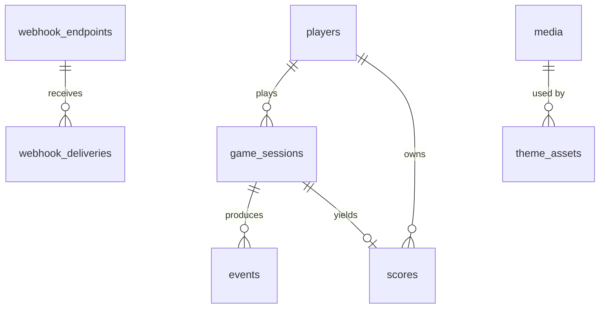

# Data Model — SQLite

- Engine: SQLite 3 via `better-sqlite3`, `PRAGMA journal_mode=WAL; foreign_keys=ON; busy_timeout=5000;`
- File: `DATABASE_PATH` (default `/data/blade-fruit.db`).
- Migrations: numbered SQL files in `server/db/migrations/`, applied at boot, tracked in `schema_migrations`.
- IDs: ULID text unless noted. Times: ISO-8601 text (UTC). JSON columns: TEXT with `CHECK(json_valid(col))`.
- All DB access goes through `server/repositories/*` so a Postgres implementation can replace it.



## Tables

### `players`
| Column | Type | Notes |
|---|---|---|
| id | TEXT PK | ULID |
| source | TEXT | `host` \| `guest` |
| external_id | TEXT NULL | token `sub` for host players |
| display_name | TEXT | |
| avatar_url | TEXT NULL | |
| meta_json | TEXT NULL | last token `meta` |
| banned | INTEGER 0/1 | |
| created_at, last_seen_at | TEXT | |

`UNIQUE(source, external_id)` (where external_id not null).

### `game_sessions`
| Column | Type | Notes |
|---|---|---|
| id | TEXT PK | |
| player_id | TEXT FK → players | |
| mode | TEXT | `classic` \| `arcade` \| `zen` |
| status | TEXT | `active` \| `ended` \| `rejected` \| `abandoned` |
| seed | INTEGER | PRNG seed for spawn sequence |
| settings_version, theme_version | INTEGER | snapshot at start |
| settings_json | TEXT | frozen copy of settings used for validation |
| last_seq | INTEGER | highest client event seq received |
| client_score, final_score | INTEGER NULL | |
| end_reason | TEXT NULL | |
| validation_json | TEXT NULL | results of plausibility checks |
| started_at, ended_at, last_event_at | TEXT | |

Indexes: `(player_id, started_at DESC)`, `(status, last_event_at)` for the abandon sweeper.

### `events` (append-only outbox)
| Column | Type | Notes |
|---|---|---|
| seq | INTEGER PK AUTOINCREMENT | global order / cursor |
| id | TEXT UNIQUE | ULID |
| type | TEXT | |
| version | INTEGER | |
| source | TEXT | `client` \| `server` |
| session_id | TEXT NULL FK | |
| player_id | TEXT NULL FK | |
| client_seq | INTEGER NULL | per-session seq from client |
| occurred_at, received_at | TEXT | |
| data_json | TEXT | |

Indexes: `(type, seq)`, `(player_id, seq)`, `(session_id, client_seq)` UNIQUE, `(occurred_at)`.
Player fields in the envelope (externalId, displayName, verified, meta) are joined at read time from `players`
and snapshotted into `data_json._player` at insert for history accuracy.

### `scores`
| Column | Type | Notes |
|---|---|---|
| id | TEXT PK | |
| session_id | TEXT UNIQUE FK | |
| player_id | TEXT FK | |
| mode | TEXT | |
| score | INTEGER | server-computed |
| verified | INTEGER | 1 if host player |
| achieved_at | TEXT | |
| removed_at, removed_reason | TEXT NULL | soft delete by admin |

Indexes: `(mode, score DESC, achieved_at)`, `(mode, achieved_at)`, `(player_id, mode, score DESC)`.

Leaderboard query (best per player in period):
```sql
SELECT player_id, MAX(score) AS score, MIN(achieved_at) AS achieved_at
FROM scores s JOIN players p ON p.id = s.player_id
WHERE s.mode = ? AND s.achieved_at >= ? AND s.removed_at IS NULL AND p.banned = 0
  AND s.achieved_at >= COALESCE((SELECT reset_at FROM leaderboard_resets WHERE mode = ? AND period = ?), '')
GROUP BY player_id ORDER BY score DESC, achieved_at ASC LIMIT ?;
```
(`achieved_at` per player is the earliest time they reached their max — computed via window function in the real
query.)

### `leaderboard_resets`
`mode TEXT, period TEXT, reset_at TEXT, PRIMARY KEY(mode, period)`.

### `media`
| Column | Type | Notes |
|---|---|---|
| id | TEXT PK | sha256 of processed bytes (hex, first 32) |
| kind | TEXT | `image` \| `audio` |
| mime | TEXT | `image/webp`, `image/png`, `audio/mpeg`, `audio/ogg` |
| file_name | TEXT | `<id>.<ext>` under `UPLOAD_DIR` |
| width, height | INTEGER NULL | |
| bytes | INTEGER | |
| original_name | TEXT | |
| created_at | TEXT | |

### `theme_assets`
One row per (status, slot). Slots: `ui.*`, `audio.*`, and per-object rows.
| Column | Type | Notes |
|---|---|---|
| status | TEXT | `draft` \| `published` |
| key | TEXT | e.g. `fruit.apple`, `ui`, `audio` |
| kind | TEXT | `fruit` \| `bomb` \| `special` \| `ui` \| `audio` |
| builtin | INTEGER | built-ins can't be deleted |
| props_json | TEXT | label, radius, points, spawnWeight, juiceColor, enabled, and media ids for `image`, `halfLeft`, `halfRight` (or ui/audio fields) |
| sort_order | INTEGER | |
| updated_at | TEXT | |

`PRIMARY KEY(status, key)`. A null media id means "use bundled default from `public/game/assets/default/manifest.json`".

### `settings`
Key/value store: `key TEXT PK, value_json TEXT, updated_at TEXT`. Keys: `gameplay` (the `/config` document),
`gameplayVersion`, `themeVersion`, `guestPlayEnabled`.

### `api_keys`
`id, name, prefix (first 8 chars for display), key_hash (sha256), created_at, last_used_at, revoked_at`.

### `webhook_endpoints`
`id, url, event_types_json, secret_enc (AES-256-GCM with DATA_ENCRYPTION_KEY), prev_secret_enc, prev_secret_expires_at,
active, last_seq, consecutive_failures, disabled_reason, created_at, updated_at`.

### `webhook_deliveries`
`id, endpoint_id, first_seq, last_seq, event_count, status (pending|succeeded|failed), attempts, next_attempt_at,
last_status_code, last_error, last_response_snippet (≤1 KB), created_at, completed_at`.
Index: `(status, next_attempt_at)`.

### `admin_audit_log`
`id, action, target, details_json, ip, created_at`.

## Retention

A daily job (in-process, 03:00 UTC):
- Deletes `events` older than `EVENT_RETENTION_DAYS` (default 90), except `score.*` and `leaderboard.*` types
  (kept indefinitely for reward audits).
- Deletes `webhook_deliveries` older than 30 days.
- Garbage-collects `media` rows/files not referenced by any `theme_assets` row and older than 7 days.
- Runs `PRAGMA optimize`.

## Backups

`sqlite3 .backup` (online backup API via `better-sqlite3`'s `db.backup()`) on a schedule configured by the operator;
volume `/data` contains the DB and uploads and is the only stateful path.
