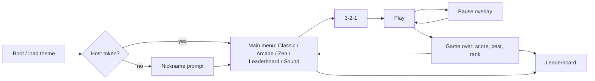

# Game Design Document — Blade Fruit

All numeric values below are **defaults**; the ones marked ⚙ are editable in the admin panel
([ADMIN_PANEL §5](ADMIN_PANEL.md#5-gameplay-settings)) and served to the client via `GET /api/v1/config`.

## 1. Core Loop

1. Objects (fruit, bombs, specials) are launched from below the bottom edge on parabolic arcs.
2. The player drags (mouse/touch/pen) to draw a blade trail.
3. Any object whose circle intersects a trail segment drawn fast enough is **sliced**.
4. Sliced fruit → points, halves fly apart, juice splatters on the background.
5. Mode rules decide when the round ends (§2). Score is submitted; leaderboard rank shown.

## 2. Game Modes

| | Classic | Arcade | Zen |
|---|---|---|---|
| Ends when | 3 strikes ⚙ **or** a bomb is sliced | 60 s timer ⚙ expires | 90 s timer ⚙ expires |
| Missed fruit | Strike (✕) — except fruit that was never on-screen | No penalty | No penalty |
| Bombs | Instant game over | −10 points ⚙ (floor 0), 0.5 s white flash | None |
| Specials | None | Freeze, Frenzy, Double Score | None |
| Strike recovery | +1 life back every 100 points ⚙ (max 3) | — | — |
| Leaderboard | Yes | Yes | Yes (separate board) |

### Arcade specials (bananas in the original — use original art)

| Special | Effect | Duration ⚙ |
|---|---|---|
| Freeze | All objects & spawn timer move at 0.4× speed; timer pauses | 5 s |
| Frenzy | Burst of fruit from both sides, no bombs | 5 s |
| Double Score | All points ×2 | 7 s |

Specials appear at most once per 8 s, with probability 6 % ⚙ per wave.

**Critical hit (Arcade):** 2 % chance ⚙ per fruit slice → +10 points with "CRITICAL!" text.

## 3. Objects

Default fruit set (theme slots — see [ADMIN_PANEL §4](ADMIN_PANEL.md#4-theme-editor)):

| Slot key | Radius (px @ 1080p) | Points | Spawn weight | Juice color |
|---|---|---|---|---|
| `fruit.apple` | 42 | 1 | 10 | `#e8f5a0` |
| `fruit.orange` | 44 | 1 | 10 | `#ffa726` |
| `fruit.watermelon` | 60 | 1 | 6 | `#ff4f6d` |
| `fruit.banana` | 46 | 1 | 8 | `#fff59d` |
| `fruit.pineapple` | 55 | 1 | 5 | `#ffe082` |
| `fruit.strawberry` | 32 | 1 | 9 | `#ff1744` |
| `fruit.coconut` | 45 | 1 | 5 | `#f5f5f5` |
| `fruit.kiwi` | 34 | 1 | 7 | `#9ccc65` |
| `fruit.pomegranate` | 48 | special: multi-slice (see below) | 1 | `#c2185b` |
| `bomb` | 40 | — | per bomb chance | — |
| `special.freeze` / `special.frenzy` / `special.double` | 44 | 1 | Arcade only | `#81d4fa` / `#ff8a65` / `#ffd54f` |

Custom fruit added by admin have the same fields. Each object type has: `image` (whole), optional `halfLeft` and
`halfRight` images (if absent, the engine clips the whole image along the cut line), `radius`, `points`,
`spawnWeight`, `juiceColor`, `enabled`.

**Pomegranate (Arcade, end of round):** appears in the last 3 s; each slice = +1, the fruit wobbles in place for up
to 3 s; a final burst gives bonus = slices × 2.

## 4. Physics

- Coordinate space: logical resolution **1920 × 1080**, scaled to the canvas preserving aspect (letterbox-free
  "cover" with safe area for HUD). Device pixel ratio capped at 2.
- Fixed timestep **1/120 s** with accumulator; render interpolated at display refresh rate.
- Gravity `g = 1400 px/s²` ⚙.
- Launch: x₀ uniform in [15 %, 85 %] of width, y₀ = height + radius. Choose apex height h ∈ [45 %, 85 %] of
  height ⇒ `vy = -sqrt(2·g·h)`. Horizontal velocity aims toward center: `vx = (target − x₀)/tFlight`,
  clamped to ±450 px/s.
- Angular velocity uniform ±4 rad/s.
- An object is **missed** when it falls below `height + radius` after having been on-screen and unsliced.
- Halves: inherit parent velocity, plus ±220 px/s perpendicular to the cut, angular velocity ±6 rad/s; despawn
  off-screen.

## 5. Spawning & Difficulty

Waves are launched every `waveInterval` seconds; each wave launches `n` objects with 0–250 ms stagger.

| Elapsed (Classic) | waveInterval | objects/wave | bomb chance |
|---|---|---|---|
| 0–15 s | 1.6 s | 1–2 | 5 % |
| 15–45 s | 1.3 s | 1–3 | 10 % |
| 45–90 s | 1.1 s | 2–4 | 15 % |
| 90 s+ | 0.9 s | 2–5 | 18 % (cap ⚙) |

Arcade/Zen use the same curve compressed to their duration. The curve is a table in `settings.difficulty` ⚙.
Rule: a wave never contains more bombs than fruit, and the first 3 s of a round have no bombs.

## 6. Slicing

- Pointer positions sampled every `pointermove` (coalesced events used when available).
- Trail = last 12 points ⚙ or last 120 ms, whichever shorter; rendered as a tapered ribbon with glow
  (theme slot `blade.texture` / `blade.color`).
- A segment counts as cutting only if its speed ≥ **900 px/s** ⚙ (logical px) — slow drags don't slice.
- Hit test: segment–circle intersection (closest point on segment to circle center, distance ≤ radius).
  Each object can be sliced once per swipe (pomegranate excepted).
- Cut angle = segment angle; halves split perpendicular to it.
- A **swipe** starts on pointerdown (or when speed rises above threshold) and ends on pointerup or when speed
  stays below threshold for 150 ms.

## 7. Scoring

| Action | Points |
|---|---|
| Slice fruit | `points` of fruit type (default 1) |
| Combo (≥ 3 fruit in one swipe) | +N bonus where N = number of fruit in combo ⚙ (combo of 3 = +3) |
| Critical (Arcade) | +10 |
| Bomb (Arcade) | −10 (floor 0) |
| Double Score active | everything above ×2 |
| Pomegranate burst | slices × 2 |

Each scoring action produces an event (see [EVENTS.md](EVENTS.md)). The server recomputes the score from the event
stream at session end ([SECURITY §3](SECURITY.md#3-score-integrity)).

## 8. Visual & Audio FX

- Juice splatter decal stays on the background, fades over 3 s; max 30 decals (oldest removed).
- Particle burst: 12 droplets per slice, pooled; global cap 400 particles.
- Combo text pops at the swipe end point; scales 0.6→1.2→1 over 400 ms.
- Bomb (Classic): bomb flashes, white radial wipe, 1 s screen shake (disabled if `prefers-reduced-motion` or
  the in-game reduced-motion toggle).
- Missed fruit: red ✕ appears at the bottom where it fell.
- Audio (theme slots): `sfx.slice`, `sfx.splat`, `sfx.combo`, `sfx.bomb_fuse`, `sfx.explosion`, `sfx.throw`,
  `sfx.gameover`, `music.menu` (optional). Web Audio API; muted until first user gesture; mute toggle persisted
  in `localStorage`.

## 9. Screens & HUD

- Menu items are fruit you **slice** to choose (like the original), plus accessible HTML buttons beneath for
  keyboard/screen-reader users.
- HUD (Tailwind-styled DOM overlay on top of canvas): score (top-left), best (below), strikes ✕✕✕ (Classic,
  top-right) or timer (Arcade/Zen), pause button. Logo from theme slot `ui.logo`.
- Pause automatically on `visibilitychange` hidden and window blur.

## 10. Performance Budget

- Sprites pre-decoded with `createImageBitmap`; halves pre-rendered once per type to offscreen canvases.
- Object pools for fruit, halves, particles, text popups. No allocations in the hot loop.
- Auto quality: if average frame time > 20 ms for 2 s, halve particles and disable glow.

## 11. Input

- Pointer Events API, `touch-action: none` on canvas, `setPointerCapture`.
- Multi-touch: each active pointer has its own trail (max 2).
- Keyboard: `Esc`/`P` pause, `M` mute, `Enter` confirm in menus.
